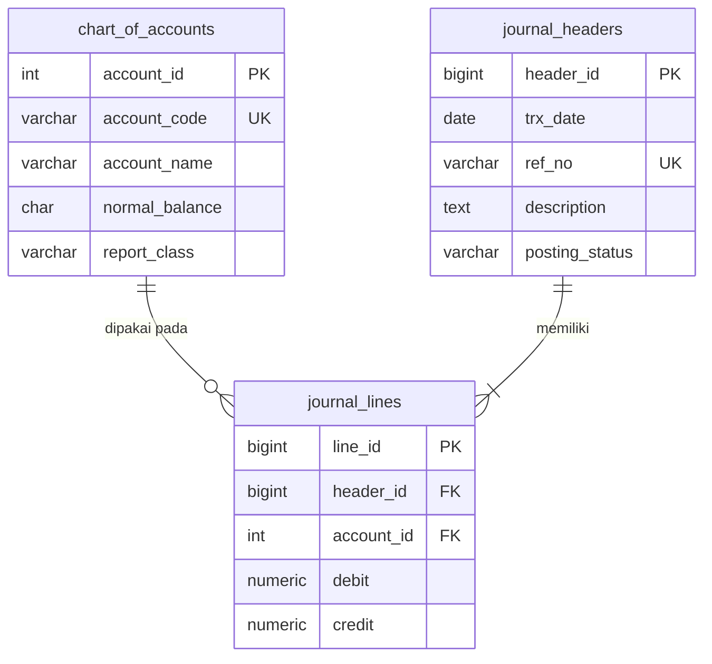

# UTS Pemrograman / Coding Akuntansi

**Departemen Akuntansi, FEB Universitas Diponegoro** | UTS Gasal TA 2026/2027 | Senin, 19 Oktober 2026
Mata kuliah: Pemrograman / Coding | Dosen pengampu: Totok Dewayanto
Sifat ujian: Open Book / Open AI / Open Code Sandbox

| Identitas | |
| --- | --- |
| Nama | ____________ |
| NIM | ____________ |
| Tautan repositori | ____________ |

## Latar Belakang

Sistem informasi akuntansi sebuah perusahaan ritel hanya memvalidasi keseimbangan debit dan kredit di sisi frontend, sehingga transaksi yang dikirim langsung lewat API dapat lolos tanpa pasangan yang valid. Selain itu, saldo persediaan di gudang berubah lebih cepat daripada pencatatan di buku besar. Repositori ini berisi rancangan dan implementasi solusinya: aturan akuntansi dipindahkan ke level database (constraint dan trigger), otomasi persediaan dibuat lewat trigger, dan modul voucher kas keluar dibuat dengan jejak audit yang tidak dapat diubah.

## Demo

| Demo | Tautan |
| --- | --- |
| Form Voucher Kas Keluar dengan Live Balanced Indicator (Gemini Canvas) | https://share.gemini.google/bMv9b9aO8ZKH |

Salinan kode form juga tersedia di repositori pada `soal-3_web-audit/3.1a_gemini-canvas/index.html` dan dapat dibuka langsung di browser.

## Ringkasan Soal dan Artefak

| Soal | Bobot | CPMK | Folder | Isi utama |
| --- | --- | --- | --- | --- |
| 1. Desain Arsitektur Data, Normalisasi, dan Asas Berpasangan | 25% | CPMK-1 | [`soal-1_desain-data/`](soal-1_desain-data) | ERD, DDL dan constraint, analisis 3NF dan audit trail |
| 2. Otomasi Bisnis, Stored Procedure, dan Trigger Persediaan | 40% | CPMK-2 | [`soal-2_trigger-persediaan/`](soal-2_trigger-persediaan) | Trigger stok dan jurnal HPP, penanganan concurrency |
| 3. Purwarupa Web Full-Stack dan Orkestrasi AI Tools | 35% | CPMK-3 | [`soal-3_web-audit/`](soal-3_web-audit) | Form voucher, verifikasi PSAK, audit trail dan immutability |
| Dokumentasi penggunaan AI | | | [`prompt-log/`](prompt-log) | Log prompt, template prompt, pernyataan penggunaan AI |
| Bukti eksekusi | | | [`bukti/`](bukti) | Screenshot hasil di sandbox dan alat AI |

Daftar periksa per butir soal ada di [`CHECKLIST.md`](CHECKLIST.md).

## Struktur Repositori

```
.
├── README.md
├── CHECKLIST.md
├── soal-1_desain-data/
│   ├── 1.1_erd/                 erd.mmd, erd.dbml
│   ├── 1.2_ddl/                 01_ddl.sql, 02_trigger_keseimbangan.sql, 03_data_dan_tes.sql
│   └── 1.3_analisis/            analisis_3nf_audit.md
├── soal-2_trigger-persediaan/
│   ├── 2.1_trigger/             01_ddl_tabel.sql, 02_fungsi_dan_trigger.sql, 03_tes.sql
│   └── 2.2_concurrency/         concurrency.md, concurrency.sql
├── soal-3_web-audit/
│   ├── 3.1a_gemini-canvas/      index.html, prompt_gemini.md
│   ├── 3.1b_notebooklm/         verifikasi_psak.md
│   └── 3.2_audit-trail/         01 sampai 05 (*.sql), spesifikasi_backend.md
├── prompt-log/                  prompt_log_claude.md, template_prompt_terstruktur.md
└── bukti/                       soal-1/, soal-2/, soal-3/
```

## Ringkasan Solusi

### Soal 1: Desain Arsitektur Data
- **1.1 ERD.** Tiga entitas: `chart_of_accounts`, `journal_headers`, dan `journal_lines`. Satu header memiliki banyak baris, dan satu akun dipakai banyak baris.
- **1.2 DDL dan constraint.** Primary key, foreign key dengan `ON DELETE RESTRICT`, CHECK `debit >= 0`, `credit >= 0`, serta `debit > 0 OR credit > 0`. Keseimbangan debit dan kredit per jurnal ditegakkan oleh constraint trigger yang ditunda sampai COMMIT, sehingga transaksi lewat API pun ditolak jika timpang.
- **1.3 Analisis.** Desain header-line memenuhi 3NF, menghindari anomali update dan delete, serta memudahkan jejak audit dibandingkan tabel tunggal.

### Soal 2: Trigger Persediaan Perpetual
- **2.1** Fungsi `trg_update_stock_and_journal()` memperbarui `stock_qty` pada setiap INSERT transaksi dan memunculkan `RAISE EXCEPTION` jika stok menjadi negatif. Untuk transaksi SALE, trigger juga memposting jurnal HPP (Debit HPP, Kredit Persediaan).
- **2.2** Race condition saat dua kasir menjual item yang sama diatasi dengan `SELECT ... FOR UPDATE`, UPDATE atomik bersyarat, atau isolasi SERIALIZABLE dengan retry.

### Soal 3: Purwarupa Web dan Audit Trail
- **3.1a** Form Voucher Kas Keluar dengan indikator seimbang secara real-time. Tombol Submit aktif hanya jika total debit sama dengan total kredit dan setiap baris valid. Perhitungan memakai satuan sen (integer) untuk menghindari galat floating point.
- **3.1b** Verifikasi aturan bisnis terhadap PSAK 2 (kas dan setara kas) menggunakan NotebookLM.
- **3.2** Jurnal berstatus POSTED dikunci oleh trigger (tidak dapat di-UPDATE atau di-DELETE). Koreksi hanya lewat jurnal pembalik (storno). Field `created_by`, `created_at`, dan `hash_checksum` (SHA-256 berantai) dicatat untuk verifikasi integritas data.

## Cara Menjalankan

**Prasyarat:** PostgreSQL 14 atau lebih baru (PostgreSQL Sandbox atau SQL Editor Supabase) dan browser modern. Form HTML memerlukan koneksi internet untuk memuat Tailwind CSS dari CDN.

Skrip bernomor dijalankan berurutan karena saling bergantung:

1. `soal-1_desain-data/1.2_ddl/`: `01_ddl.sql`, `02_trigger_keseimbangan.sql`, `03_data_dan_tes.sql`
2. `soal-2_trigger-persediaan/2.1_trigger/`: `01_ddl_tabel.sql`, `02_fungsi_dan_trigger.sql`, `03_tes.sql`
3. `soal-3_web-audit/3.2_audit-trail/`: `01` sampai `05`
4. Buka `soal-3_web-audit/3.1a_gemini-canvas/index.html` di browser, atau kunjungi tautan demo di atas.

Hasil pengujian muncul sebagai pesan "OK ditolak" atau "GAGAL" di tab Messages atau Notices pada sandbox. Menjalankan ulang `01_ddl.sql` akan mereset tabel Soal 1.

## ERD (Soal 1.1)



## Alat yang Digunakan

| Keperluan | Alat |
| --- | --- |
| Basis data dan eksekusi SQL | PostgreSQL Sandbox / Supabase |
| Prototipe form voucher | Gemini Canvas |
| Verifikasi kepatuhan PSAK | NotebookLM |
| Asisten penyusunan jawaban | Claude (Anthropic) |
| Diagram ERD | mermaid.live, dbdiagram.io |
| Penyimpanan dan dokumentasi | GitHub |

## Dokumentasi Penggunaan AI

Ujian ini bersifat Open AI. Seluruh penggunaan alat AI dicatat di [`prompt-log/`](prompt-log), berisi prompt, ringkasan hasil, artefak terkait, dan langkah verifikasi:

- [`prompt-log/prompt_log_claude.md`](prompt-log/prompt_log_claude.md): log prompt Claude beserta pernyataan penggunaan AI
- [`soal-3_web-audit/3.1a_gemini-canvas/prompt_gemini.md`](soal-3_web-audit/3.1a_gemini-canvas/prompt_gemini.md): log prompt Gemini Canvas
- [`soal-3_web-audit/3.1b_notebooklm/verifikasi_psak.md`](soal-3_web-audit/3.1b_notebooklm/verifikasi_psak.md): hasil verifikasi NotebookLM
- [`prompt-log/template_prompt_terstruktur.md`](prompt-log/template_prompt_terstruktur.md): template prompt (Peran, Konteks, Tugas, Format, Batasan)
